# Session context: 2026-10-08

Record of everything done in the working session of 8 October 2026 on the project "ML-assisted optimization of skipper-CCD operating parameters". It is meant to let someone (or a later session) pick the work up without the conversation. Figures are in `figures/` next to this file; all code is in `../../src/`.

Status in one paragraph: the acquisition scripts (take a labeled packet, scan settings) are written and tested only against a fake DAQ; a decoder for the raw trace format is written and checked against the data; a set of 39 comparison tools with a permutation-test verdict is built and tested on real traces (channel 0 against channel 3, and repeats of channel 0). **No operating parameter has been varied in any real data yet, and no ML model has been trained.** The ML plan (surrogate model plus optimizer, trained on traces and image-derived physics values) is written down but not implemented.

---

## 1. Project goal as settled in the conversation

* **Optimize the operating parameters**: bias voltages (`VSUB`, `VDD`, `VDRAIN`, `VR`), rail voltages (clock high/low levels) and timing parameters (transfer hold times, integration/reset/summing-well/output-gate delays), to get a calibrated image with **low readout noise σe, low dark current λ, and a known gain g**.
* **Training data**: packets that contain *both* a trace and a calibrated image (WADERs/`panaSKImg`) taken at **the same settings**. The image gives σe, g, λ; the trace gives tool values.
* **What the model learns**: how the settings affect σe, g, λ (a forward surrogate, settings and trace features -> physics values, with uncertainty).
* **What it does at use time**: from an input trace (plus the settings it was taken at) predict noise, dark current and gain, and **suggest new settings**. The suggestion is produced by a search (Bayesian optimization, multi-objective, with safety limits) over the learned model, not by a network trained to output the change directly (the labels never say which change is "the" answer; many changes can help).
* The problem is a constrained, noisy, multi-objective, **multi-fidelity black-box optimization** (cheap trace, expensive image), related to hyperparameter tuning but with hardware limits, parameter relationships, run-to-run noise, memory of previous acquisitions, and amplifier dependence.
* Possible staging: **Stage A** Bayesian optimization directly on image-derived values; **Stage B** add the trace as a cheap fidelity once it is shown to track the physics values. Not yet decided by the user.

Figures: `figures/ml_example.png`, `ml_training.png`, `ml_optimize.png`, `ml_tradeoff.png`.

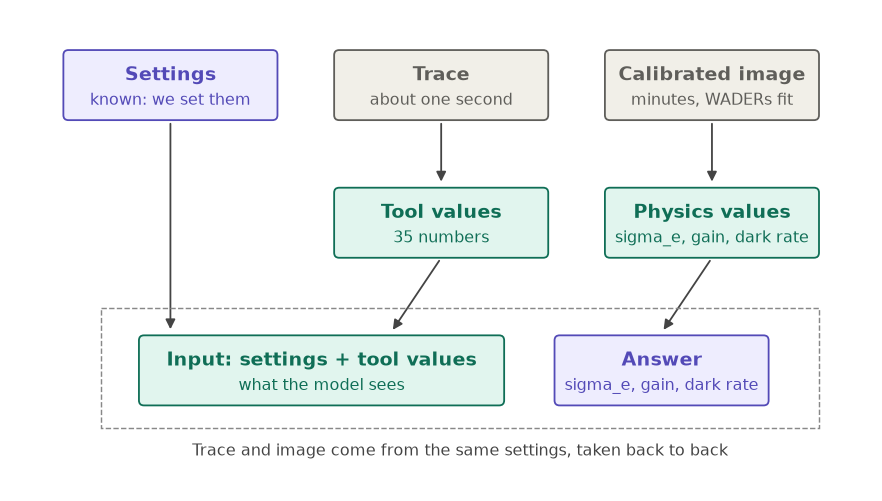
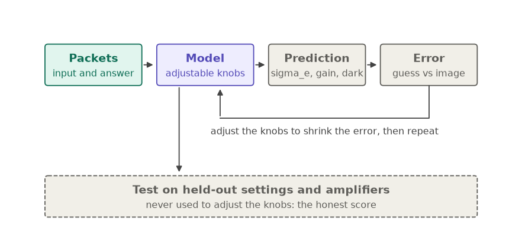
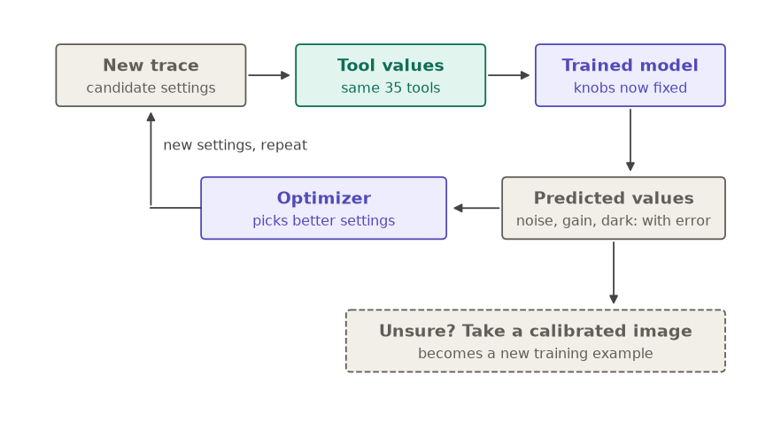
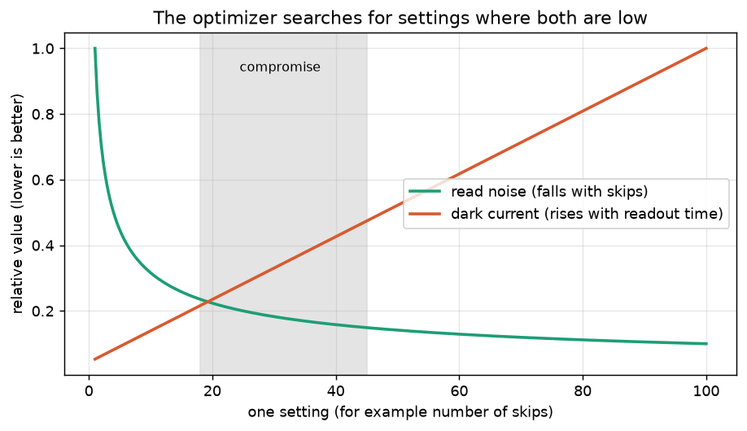

## 2. Material read

* **`docs/`**: about 35 PDFs (LBNL fully depleted CCD papers, skipper CCD papers by Janesick, Chandler, Moroni, DAMIC-M papers, LBNL read-noise slides, the CCD manual) plus the group's notes. The core documents: `v2_ccd_ml_proposal.pdf` (draft v0.3, 7 Oct 2026: problem formulation P1 to P4, information limits, indirect inference of gain and dark current from the trace, dataset design, data-taking phases, candidate models, closed loop, multi-CCD extension, month-one plan) and `ccd_noise_v3.pdf` (noise landscape: kTC, CDS weighting, source-follower noise, correlated noise, dark current, droop, spurious charge, coupling matrix). PDFs were converted to text with `pypdf` in a scratch virtual environment.
* **`pysimdamicm` (WADERs, `panaSKImg`)**: process chain Compress -> PedestalSubtraction -> FitDarkCurrent -> Calibration -> ClusterFinder -> BuildClusterMask. Calibrated FITS holds `CALIBRATED` (electrons) and `FULLMASK` (1 = excluded). Labels are header keys `MEGAIN<n>`, `MESIG<n>` (ADU), `MEDC<n>` per amplifier extension (`EXT<n>`), with errors; σe = MESIG/MEGAIN, λ = MEDC/MEGAIN per bin per image. **Not saved by WADERs**: fit chi², any quality flag, the WADERs version (only in the ROOT `process_config` if ClusterFinder ran). Fit model: Poisson-weighted comb of Gaussians; a possible off-by-one in the initial parameters (lambda slot gets the gain guess) was noted but the fit still converges.
* **`Soft_JHU/cdaq` (DAQ)**: command path `cdaq qadd` -> MQTT -> client -> `acmpy.ACM` -> `run_acmdaq.exe` (UDP to the board). `qadd` is fire-and-forget (completion only via retained MQTT status). No voltage limits in the C++/MQTT layer.
* **`Soft_JHU/commant`**: quick plotting; `l0plot` uses `acmpy.Decoder(file).df0_view` (columns `val`, `RD`, `RU`), assumes 15 MHz. The decoder itself is a compiled Linux library (`acmdecoder`), source not available locally, so decoding was re-implemented (section 4).
* **`acmpy` source** was read **only with `git show`** from the nested repository (no checkout, no push/pull): bias circuits and DAC ranges, `erase_ccd`, `epurge_ccd`, `take_image`/`take_trace`, sequencer handling. Facts used: bias values are quantized by potentiometer codes (request 45 V -> readback 45.095 V); `ACM(...)` does not power up the CCD; a new `ACM` loads `reference_v5.seq` by default; `atexit` kills the `acmdaq` screen when the process exits.

## 3. Data in `data/`

* Original sample trace set (module 101 and 102, identical settings, 2x5x500, 20x20 binning) and one L2 sample FITS (80x320, NDCM=1).
* `2026-10-06-PA03_PQ04_Installation_Check130K_1/`: copy of `~/Documents/JH1_Testing/...` (363 MB, images and traces; **no electrical parameter varies in any file**, only image geometry).
* `2026-10-08-PA03_PQ04_traces/`: new session of **20 traces of module 101, identical settings** (5 repeats x 4 channels; the same folder has module 102 files, which were **not used**, by instruction). Four ch0 repeats within 12 s and one 90 s later.
* `decoded/trace_ch0_acm101.csv` (52 MB): decoded trace as `sample,val,RD,RU`.
* **Instructions given by the user** that constrain everything: do not use module 102; use module 101 channels 0 and 3 for comparisons; do not edit anything outside `ccd_opt_ml`; git: `git show` allowed, no push/pull; temperature is fixed for now.

## 4. Trace format and decoding (verified)

File = big-endian 32-bit words (`decode_trace.py`):

* keyword words (bit 31 set): START `0xD3544152`, BUSY, header, END `0xA0454E44`;
* raw samples: top nibble 2, **low 20 bits = signed ADC value**, flag bit 0 = RD (pedestal window), bit 1 = RU (signal window);
* inline L1 records: header word (top nibble 5, pixel in the low nibble of the flag, bit 7 = signal window, value = 150 samples) followed by a 31-bit signed **sum of the 150 samples**;
* other words (end-of-pixel records) kept undecoded.

**Verification**: the inline sums equal the sums of the raw samples in the flagged windows, difference 0 on all 10,010 records of the sample trace; windows are exactly `delayInt` long (150 samples = 10 µs at 15 MHz). Flag bits 5 (vertical) and 6 (horizontal) were *inferred* from where they toggle. One-sample flag glitches (seen on a ch3 trace) are now filtered.

Structure of a trace (sample run: 2x5x500, 20x20 binning, BOOLCLR=0):

* skip cycle 489 samples = 32.6 µs (3258 clock cycles = 488.7 samples; the non-integer period causes a 3.33-skip beat in sharp edges, about ±4000 ADU at the pulse peak), pedestal window 150 samples, signal window starting at sample 207 (13.8 µs);
* per pixel: 20 horizontal transfers (1894 samples = 126 µs each, 2.5 ms total) then 500 skip cycles (16.3 ms); one **extra pedestal window per pixel** (`ReadoutPedestal`);
* per row: 20 vertical transfers (5404 samples = 360 µs each), 10 pixels = 2 rows of 5.

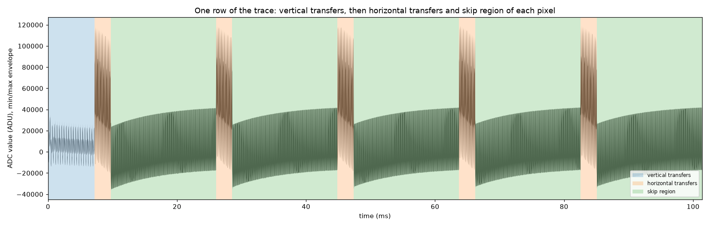
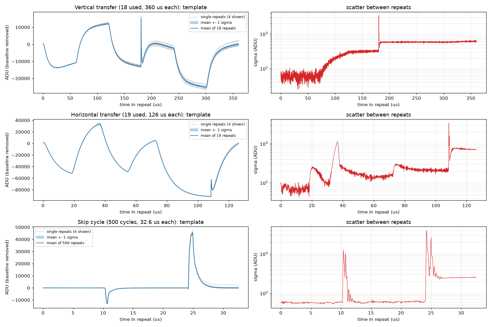

Observations on one pixel (`figures/skip_evolution.png`): baseline droops from about −22,000 to −3,500 ADU over 500 skips (reset leakage); the CDS of the first skips rings (skip 0 about 320 ADU against 35 later); smooth drift explains only 0 to 3% of the skip-to-skip scatter of the shape; the shape is otherwise very reproducible.

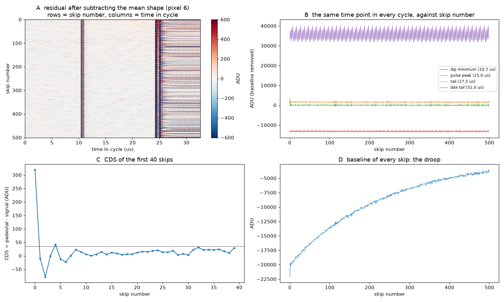
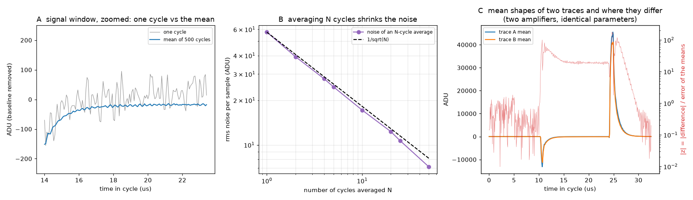

## 5. Acquisition code (src/)

> **Superseded on 2026-10-09**: the acquisition scripts were rewritten to work through the cdaq queue (master/slave images, standalone traces, reference traces per packet); see `2026-10-09_session_context.md`. The table below describes the first version.
>
> Detailed handoff for these scripts (usage, safety checks, manifest, untested hardware assumptions, gaps, first-test checklist): [data_taking_scripts_handoff.md](data_taking_scripts_handoff.md).

All written this session; **tested only against `fake_daq.py`**, never on hardware. The `acm` backend has not been run.

| File | Role | Inputs -> outputs |
|---|---|---|
| `ccd_limits.py` | Safety. Hardware ranges from `acmpy` (bias circuits, DAC rails), windows from TOML (first matching glob wins; unknown parameters refused), `relational_constraints` (only "high >= low" now; **the bias/clock relationships are a placeholder awaiting the group's rules**), `ramp_plan` (voltage steps no larger than `max_step`). | θ dict -> raises or ramp steps |
| `take_packet.py` | One packet: validate -> apply θ (ramped) -> optional erase (**no e-purge, as instructed**) -> one short trace per channel -> image -> manifest `packets/<id>.json`. Watchdog thread for hangs; sequencer name checked against the loaded one; `--validate-only` rehearsal; `connect_acm` loads the pumping sequencer. | PacketRequest -> raw files + manifest |
| `scan_packets.py` | Scan plan (reference, one-at-a-time / random / list designs, reference re-inserted every N, seeded shuffle), `--dry-run`, resumable, stops at first failure. | scan TOML -> packets |
| `fake_daq.py` | Stand-in for `acmpy.ACM` writing placeholder files with the real naming. | |
| `configs/limits.toml` | **Provisional windows** around the reference configuration, `reviewed = false` (real hardware is refused until reviewed). | |
| `configs/scan_example.toml` | Reference: `EXPOSURE 10, NDCM 500, NROW 100, NCOL 130, NPBIN 1, NSBIN 10 (the user's snippet; true 1x1 would be NSBIN 1), NCOLPRE 500, BOOLCLR 1`, level 2; design varies `delay_Ha`, `delay_Va`, `VSUB`, `VR`. | |

User decisions on the scan: skips fixed at 500 and binning fixed (so images stay comparable); scan only timing and biases/rails first; start small. Erase is used between parameter changes (policy `on_voltage_change`), never e-purge.

**Timing**: the image time estimate now uses `acmpy`'s own sequencer compiler when `acmpy` is importable (same method as the group's `image_time.py`), with a formula fallback hand-coded from `reference_v5_pumping.seq`. Checked against measurements: 100x130x500 image with `NCOLPRE=500`, `BOOLCLR=1`: formula 6.3 min against about 6 min measured; 80x320x10 L1 image: 136 s against 138 s; 2x5x500 trace: 0.203 s against 0.2 s. My first formula (19 min per image) was wrong because it counted skipped prescan columns as fully read pixels and omitted the register clear. Cell costs: ReadPixel, SkipPixel (no CDS), ClearRegister (about 0.78 s per row with `BOOLCLR=1`).

**Known gaps in the packet manifest**: it stores only the commanded θ, the erase flag and file references. **Still to add**: reference packet id, θ_ref and Δθ, previous θ, seconds since the previous acquisition, and the board readback values (taken from the `.meta`).

## 6. Analysis code (src/)

| File | Role |
|---|---|
| `decode_trace.py` | Decoder (above). `DecodedTrace`: values, RD/RU, flags, L1 records, `skips()`, `skip_cycles()`, `check_l1()`, **`quality_problems()`**, `to_csv()`. |
| `trace_regions.py` | `split_regions`: skip cycles, horizontal transfers, vertical transfers, region positions. Found from the data (window flags, gaps, flag edges), with hardcoded thresholds and the flag-bit assumptions (listed in the conversation: 2x cycle, 1.5x horizontal block, 100-sample margin, bits 5 and 6). |
| `compare_trace.py` | The comparison: 39 tools, permutation test, controls, verdict. CLI `python compare_trace.py A B [--clean-pixels] [--csv out]`. |
| `plot_trace_csv.py`, `plot_trace.py` | Plain trace plot from the CSV; the first 4-panel overview. |
| `plot_regions.py`, `plot_skip_evolution.py` | Region/template figures; skip-by-skip evolution. |
| `plot_tool_figures.py` | Annotated tools figure and the repeat-versus-amplifier comparison figures. |
| `plot_ml_diagrams.py` | The ML schematic diagrams. |
| `view_trace.py` | Interactive HTML viewer (whole trace embedded, min/max pyramid, jump menu, robust y scale). Tested in the built-in browser via a temporary local server (stopped). |
| `plot_trace_interactive.py` | Interactive **matplotlib** window of the whole trace (wheel zoom, key shortcuts, check boxes). Tested headless only. |

### The 39 tools (35 enter the verdict)

* 11 **fits** (numpy only): exponential for dip recovery, settling after the pulse and baseline droop (variable projection plus parabolic refinement); damped ringing of the first 20 CDS values; noise model σ(N)² = σw²/N + σf². Each reports time constants and amplitudes.
* 19 **skip** tools: mean shape, baseline droop curve, dip height, signal-window level, pulse peak height, tail level, baseline at skip 1, droop total and half-time, CDS mean, CDS rms (detrended), first-skip excess, skips 1 to 4 ringing, lag-2 autocorrelation, noise of 10- and 50-skip averages, noise power in 0.1-1, 1-3, 3-7.5 MHz.
* 5 **horizontal** tools and 4 **vertical** tools. **Vertical tools are information only**: the control showed consecutive vertical transfers are not exchangeable.
* Statistic: Welch z per tool (RMS z for curves); permutation test with replicate = pixel (horizontal: pixel mean; vertical: transfer). Verdict threshold Bonferroni 0.01/35 = 2.9e-4. **p-values are exact** when there are at most 50,000 labelings (8 + 8 pixels: 12,870 labelings, smallest possible p = 1.6e-4, many strong tools tie there); otherwise 10,000 random relabelings.
* Controls on trace A alone: even vs odd pixels, first vs second half (row 1 vs row 2); both must say "same".
* `--clean-pixels` (`usable_pixels`): excludes row-start pixels and charge-contaminated pixels (CDS mean beyond 8 MAD, floor 5 ADU). Off by default.

Documentation: `docs/trace_fit_tools.tex` (every tool, equations, how it is computed, results, limitations; appendix with all 39 results) and `docs/ml_training_plan.tex` (the ML plan). **Neither LaTeX file has been compiled** (no LaTeX on the machine); braces, environments and references were checked.

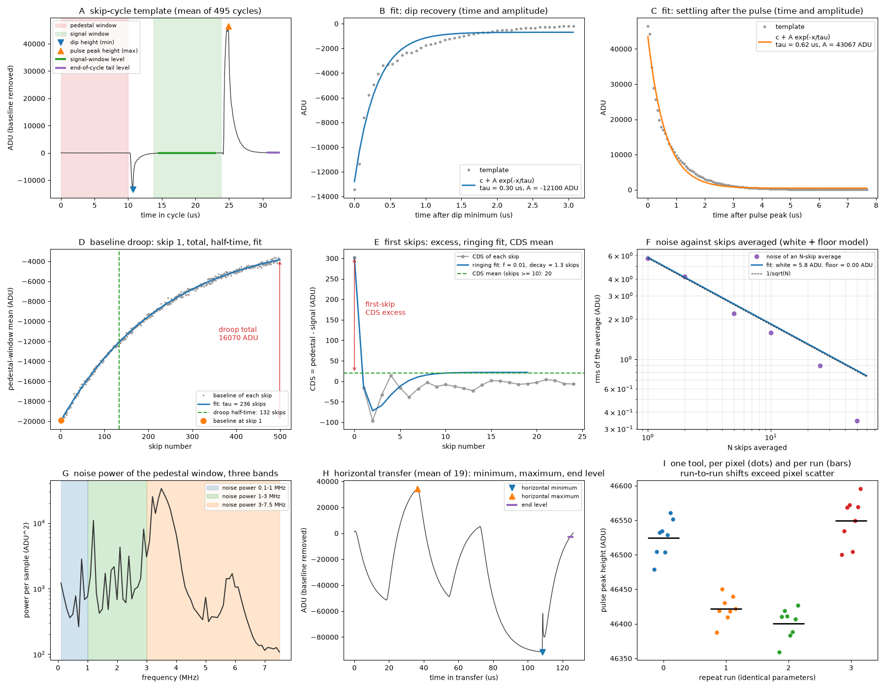

## 7. Results

### Channel 0 against channel 3 (module 101, identical parameters)

* Distinguishable. Old pair (10-06 files, 10 vs 10 pixels): 19 of 35 tools distinguish (10 skip, 5 fit, 4 horizontal). Same-session pair with cleaned pixels (8 vs 8): **18 of 35**, controls pass. Strongest: dip height, pulse peak height, dip recovery time and amplitude, settling time and amplitude, mean shape, noise power 1-7.5 MHz, horizontal shape tools.
* Fit values (ch0 / ch3): settling time 0.62 / 0.58 µs, dip recovery time 0.32 / 0.40 µs, droop time constant 237 / 241 skips, white noise 5.8 / 6.9 ADU. Time constants differ by about 2 to 26%; amplitudes differ strongly (amplifier gain/coupling).
* Both channels are *different amplifiers with identical parameters*, so this shows the tools are sensitive to the amplifier. **It does not show that parameter changes are visible.**

### Repeats of channel 0 (identical parameters, the honest test)

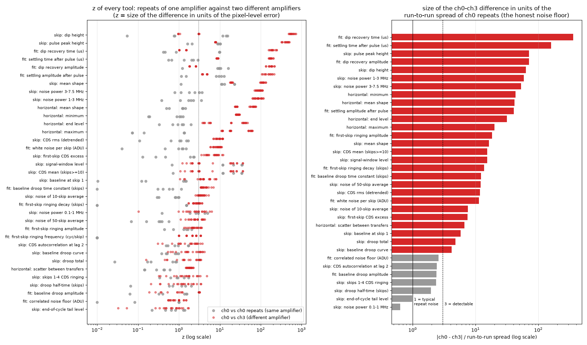
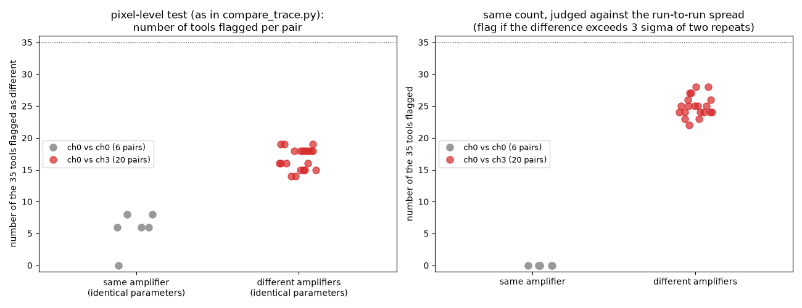
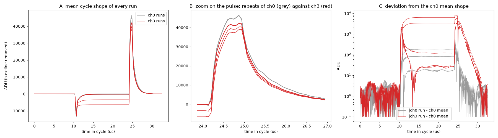

* One of five ch0 traces (…185455) **lost data** (about 2% fewer words, 183 fewer inline records, windows of 84 to 150 samples, first pixel with 412 skips; keyword framing intact, so likely dropped network packets). It is detected by `quality_problems()`; `compare_trace.py` refuses damaged traces unless `--allow-damaged`.
* **The pixel-level test is overconfident for repeats**: pairs of identical-parameter repeats are flagged 0 to 8 of 35 times (6, 8, 0, 6, 6, 8) against 14 to 19 for ch0 vs ch3. Causes found: a pixel holding a large charge (CDS mean 18,680 ADU, pulse peak and dip distorted); row-start pixels (0 and 5) with baseline about −33,000 vs −19,000 ADU; the CDS level changed between back-to-back runs (about 25, 80, 290, 25 ADU in time order, probably real charge, not confirmed); and **run-wide shifts** (pulse peak shifts by about 74 ADU = 0.16% between runs while the pixel-scatter error is about 9 ADU).
* Judged against the **run-to-run spread** (the honest noise floor): same-amplifier pairs flagged 0 times, cross-amplifier pairs 22 to 28. Ratio of the ch0-ch3 difference to the run-to-run spread: dip recovery time 358, settling time 160, pulse peak height 71, dip recovery amplitude 71, dip height 63, noise power 1-3 MHz 59. Below the "detectable" line of 3: noise power 0.1-1 MHz 0.6, tail level 1.0, droop half-time 2.0, skips 1-4 ringing 2.4, droop amplitude 2.4, lag-2 autocorrelation 2.4, correlated floor 2.6; the ringing frequency has no run-to-run variation (fit pinned at 0).
* **CDS mean and signal-window level are useless as parameter tools** (they track charge). Time constants and horizontal shapes are the trustworthy ones under the pixel-level test; edge amplitudes look false-alarm prone under it but are 60 to 70 times above the run-to-run spread.
* Minimum detectable change (about 3x the run-to-run spread): roughly 0.5% of the pulse peak or dip height.
* Noise: σ(N) of N-skip averages falls **faster than 1/√N** (0.34 ADU at N = 50 against 0.81 expected) because consecutive CDS values are anti-correlated (lag-2 autocorrelation about −0.2); the white + floor model cannot describe this (floor 0.16 / 0.22 ADU).

## 8. Notebook

`notebooks/trace_comparison_walkthrough_v2.ipynb` (executed, outputs saved): 11 steps (decode, regions, one pixel, summary tools, fits, replicates, A vs B with z and p panels, how the permutation test works, controls, full report, real repeats with p-values per tool). **Incident**: the user edited and saved `trace_comparison_walkthrough.ipynb` (kernel `damic`; cell 5 window `start - 10 ... start + 3*6000`; cell 12 `PIXEL = 0`) from a copy that predated my later updates, so their file lacks the p-value panel and the new Step 11. I did not overwrite it: `..._v2.ipynb` is my latest version **with their two edits and kernel** merged. The generator script for the notebook lives only in my scratch area (not in the project).

## 9. Mistakes found and corrected during the session

1. First-look trace comparison paired pedestal and signal records globally (each pixel has one extra pedestal window): CDS rms 1400 ADU was wrong, 19 ADU is right.
2. Image-time formula (19 min) was wrong; now follows the sequencer (about 6 min).
3. Detrending the CDS with a 25-skip running mean cancelled block averages and made "noise of N-skip average" and "floor = 0" artifacts. Replaced by a degree-4 polynomial.
4. Permutation p = 0 bug (rounding), and 3000 shuffles making flags impossible; now exact enumeration up to 50,000 labelings and a warning when the floor is above the threshold. This raised the repeat false-flag counts from 0-5 to 0-8, so the earlier numbers were partly hidden by sampling noise.
5. Vertical-block tools are not exchangeable repeats (first control failure): now information only.
6. A plotting overplot hid the false alarms behind the A-vs-B markers (fixed with offsets and draw order).
7. An early figure compared against module 102 (before the instruction); replaced with module 101 channel 3.
8. I stated 19 tools separate A and B; the correct count is 18 (same-session pair).
9. Interactive viewer: "clipped outliers" note showed at harmless zooms (fixed).

## 10. Open items and next steps

* **Bias/clock relationships** to encode in `ccd_limits.relational_constraints` (waiting for the group's rules); review `limits.toml` and set `reviewed = true`; add summing-well/output-gate/reset-gate/dump-gate rails and the other delays to the limits if they are to be scanned.
* Add the manifest fields (reference id, θ_ref, Δθ, previous θ, time since previous acquisition, readback values).
* **First real scan** with labels: reference at least 5x interleaved, several values per parameter plus some combinations, all four amplifiers, images for σe at the target number of skips, a gain image per voltage set, long exposures for λ on a subset; pause or flush between acquisitions.
* Write the **packet processing script** (decode, WADERs with saved chi² and version, group into training data); not written.
* Add the multivariate reference test, grouped-CV classifier two-sample test (with a negative control) and injection-recovery to the notebook; later response-direction regression and a Gaussian-process surrogate with Bayesian optimization.
* Make the region cutting verify its own assumptions and turn the hardcoded constants into parameters.
* Test the `acm` backend and `plot_trace_interactive.py` with a real window, and compile the two LaTeX notes.
* Decide: Stage A (optimizer on images only) first, or the trace-based surrogate from the start.

## 11. Environment notes

* Scripts run with Python 3 and numpy; plotting needs matplotlib; the notebook needs Jupyter. A scratch virtual environment (in the session's temporary scratchpad, outside the project) holds `pypdf`, `numpy`, `matplotlib`, `nbformat`, `nbclient`, `ipykernel`; it is not part of the project.
* The machine has no LaTeX installation.
* `data/` is about 694 MB (includes the 363 MB copy of the test folder and the 52 MB CSV).
* Quick start:
  * `python src/decode_trace.py TRACE [--csv out.csv]`
  * `python src/compare_trace.py A B --clean-pixels --csv out.csv`
  * `python src/plot_trace_interactive.py TRACE`, `python src/view_trace.py TRACE`
  * `python src/scan_packets.py --scan configs/scan_example.toml --limits configs/limits.toml --dry-run`
